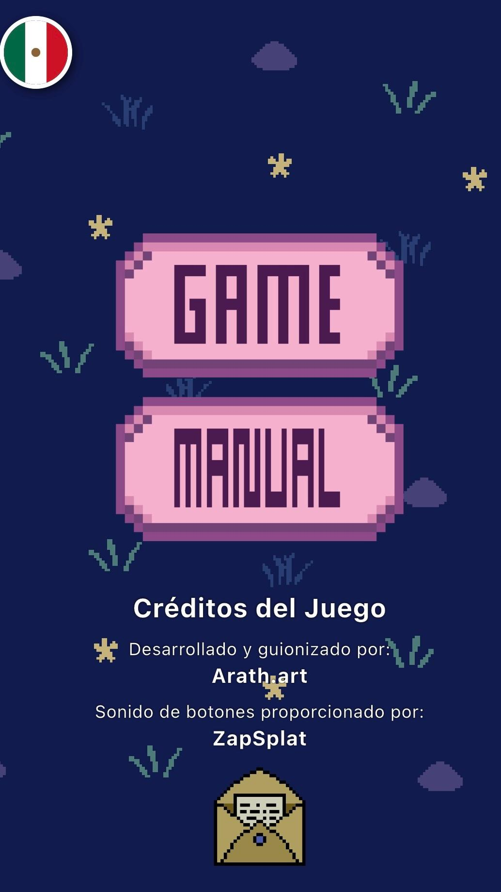
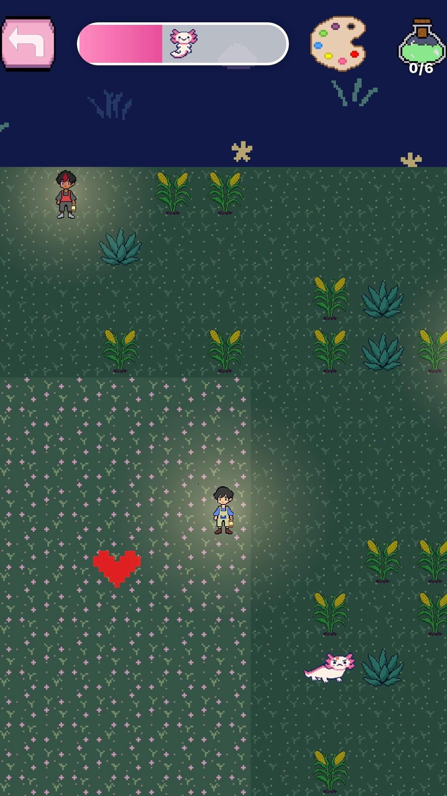

# Axolote

Mobile game developed with Flutter and published on Google Play and the App Store.

## Overview

Axolote is an independent mobile game developed and maintained by a solo developer.

The game combines exploration, collectible cards, interactive storytelling, and character progression. It is available on Android and iOS.

## Highlights

- 10,000+ downloads
- 4.5★ rating on Google Play
- Published on Google Play
- Published on the Apple App Store
- Monetized with Google AdMob
- Independently developed and maintained

## Technologies

- Flutter
- Dart
- Firebase
- Google AdMob

## My Role

As the sole developer, I was responsible for:

- Game design and development
- Programming and game mechanics
- User interface implementation
- Interactive storytelling and dialogue systems
- Android and iOS publishing
- Google AdMob integration
- Maintenance and updates

## Screenshots

### Main Menu

The main menu features the game's pixel-art visual style and provides access to gameplay and other features.

### Exploration and Gameplay

Explore pixel-art environments, interact with characters, and progress through the game.

### Interactive Story

Experience the story through character dialogue and visual novel-style scenes.

## Project Status

Published on Android and iOS, with ongoing maintenance and updates.

## Developer

Developed by [ArathArt](https://github.com/ArathArt).

