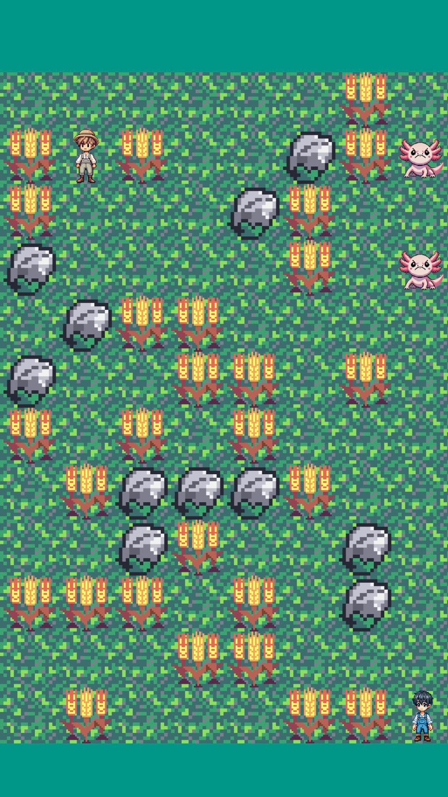
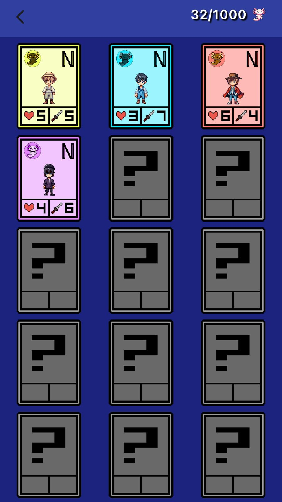
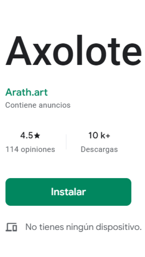

# Axolote

Mobile game developed with Flutter and published on Google Play and App Store.

## Overview

Axolote is an independent mobile game project developed and maintained by a single developer.

The game combines exploration, collectible cards and story progression, and has been published on both Android and iOS platforms.

## Highlights

- 10,000+ downloads
- 4.5★ rating on Google Play
- Published on Google Play Store
- Published on Apple App Store
- Monetized using Google AdMob
- Developed independently

## Technologies

- Flutter
- Dart
- Firebase
- Google AdMob

## My Role

This project was developed independently, including:

- Game design
- Programming
- UI implementation
- Publishing process
- AdMob integration
- Maintenance and updates

## Screenshots

### Logo

### Gameplay

### Card Collection System

### Store Statistics

